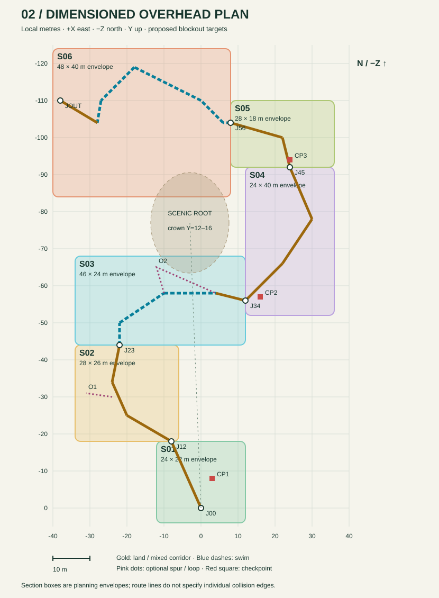
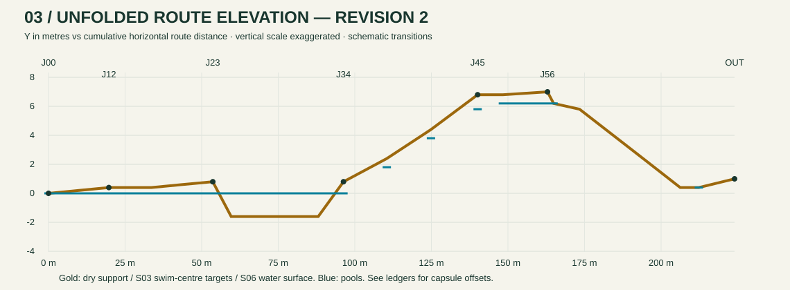

# Living Cascade — concept and drawing guide

Published 28 October 2026 from the existing local design archive. Start with the [current section storyboard](../first-adventure-storyboard.md) for gameplay intent and quality review. This page makes the original visuals portable without promoting historical implementation notes into current requirements.

## Hero view and top-down concept

The original PNG is extracted without re-encoding from the design page. Preserve its inviting turquoise water, pink hero, warm stone, living-root framing, ascending terraces and flowering crown. The crown is the distant destination; the nearby stones and root opening establish the next action. Illustrated foliage, stone count, scale, route arrows and falls are composition cues, not literal collision geometry or extra objectives.

## Overhead drawing

Read S01 Arrival Pool → S02 Stepping-stone Garden → S03 Hollow-root Dive → S04 Cascade Terraces → S05 Restoration Garden → S06 Waterfall Run. Join markers connect sections. CP1–CP3 identify the three checkpoints. O1/O2 are optional discoveries. Boxes are planning envelopes; route lines do not specify landing edges. The O1 spur is out-and-back: an older pictured reconnection does not override the revision-2 section ledger.

## Elevation drawing

The vertical scale is exaggerated. Dry support heights, underwater body-centre targets and chute water surfaces have different meanings; do not place every route point at the hero's feet. Use the [section and water ledger](../../../dev/living_cascade/design_reference.json) to disambiguate values, and remeasure clearance with the current controller before building.

## Starting lagoon visual benchmark

This is a historical in-game capture, not a new validation result. Use its pale sand, warm sandstone, clear water and tropical foliage for visual continuity into the Cascade. The leftmost tunnel leads to this adventure. Current camera and character quality must be reviewed using a current build.

## How the references fit together

| Reference | Governs | Does not establish |
|---|---|---|
| Hero illustration | Mood, silhouette, landmark hierarchy and reveal composition | Exact dimensions, collision, enemy roster or completion rules |
| Overhead/elevation drawings | Broad route, section relationships and proposed height progression | Measured controller reach or proof of safe seams |
| Revision-2 ledger | Authored numerical targets, joins, pool relationships and section constraints | Current passing evidence or new requirements inferred from old prose |
| [Surface/underwater art board](../../../asset_inbox/Reference%20Image_2_Level_1.png) | Asset family, natural forms and underwater palette | Mandatory asset repetition or trustworthy dimensions from the picture |
| [Current storyboard](../first-adventure-storyboard.md) and live NodeSpec | Current section intent, visual review and agreed gameplay decisions | Certification that implementation already meets the brief |

## Superseded details to avoid restoring

- Use complete selected assets with authored connecting terrain. Early facade-only and repeated enlarged-shape experiments are historical.
- Underwater arches use blue mineral rock with layered fine textures. The intermediate warm-tunnel treatment is superseded.
- Ordinary off-map escape is a defect with nonlethal checkpoint fallback. Older one-life fall-recovery notes are superseded; containment must work at the visible shore, not just a remote safety floor.
- Current population is three land Netbots and five Hooklines across land and water. Older swimming-Netbot, drone and boss sketches are not this workflow's roster.
- Preserve the three checkpoints and automatic 3 + 4 seed restoration: nine seeds available, seven in the garden alone. Optional discoveries, crayfish and dance never gate the finish.
- The finale is a contained, reversible chute beside the scenic waterfall. It does not require freefall, waterfall ascent, a whirlpool or a boss. Completion uses the existing reach-volume flow and returns to the lagoon.

The [source manifest](source-manifest.json) records original visual hashes. The historical multi-megabyte HTML page is not the active brief: its embedded art is preserved here, while stale status banners, local machine paths and links to old review captures are excluded. No original visual pixels or SVG drawing elements have been changed.
